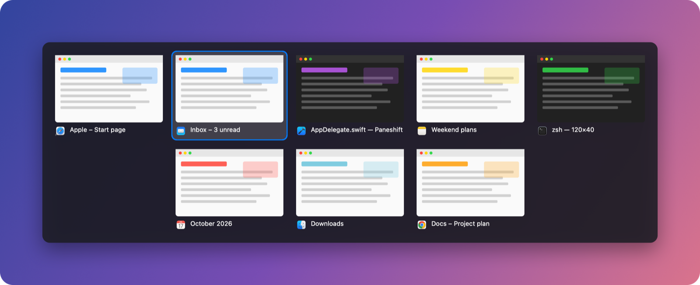

# Paneshift

Windows-style Alt-Tab for Mac: **⌘Tab between every window, with live previews**, in an app that uses
about 10 MB of memory.

**[Download the free trial](https://github.com/lmai5/paneshift/releases/latest/download/Paneshift.zip)** ·
**[Website](https://lmai5.github.io/paneshift/)**

- Every window gets a tile, including minimized ones.
- Live previews, captured only while the switcher is open and never saved or sent anywhere.
- Keyboard (Tab, Shift+Tab, arrows) and mouse (point and click).
- Close and quit from the switcher: ✕ or ⌘W closes a window, ⌘Q quits its app. Closing an app's last
  window quits the app too, like on Windows (optional).
- Lists windows of menu-bar apps too, such as their settings windows.
- Apps running with no open windows get a tile too, so you can reopen or quit them.
- Turn it off or quit any time to get the macOS switcher back.

14-day free trial, then $1.99 once. Requires macOS 14 or later; Apple Silicon and Intel.

## Install
1. Download and unzip `Paneshift.zip`, drag **Paneshift** to Applications and open it.
2. Allow **Accessibility** (required) and **Screen Recording** (optional, for previews) when the setup window asks.
3. Press ⌘Tab.

## Support
Found a bug or have a request? [Open an issue](https://github.com/lmai5/paneshift/issues).

This repository hosts releases and the website; Paneshift's source code is not public.
© 2026 Paneshift. All rights reserved.
